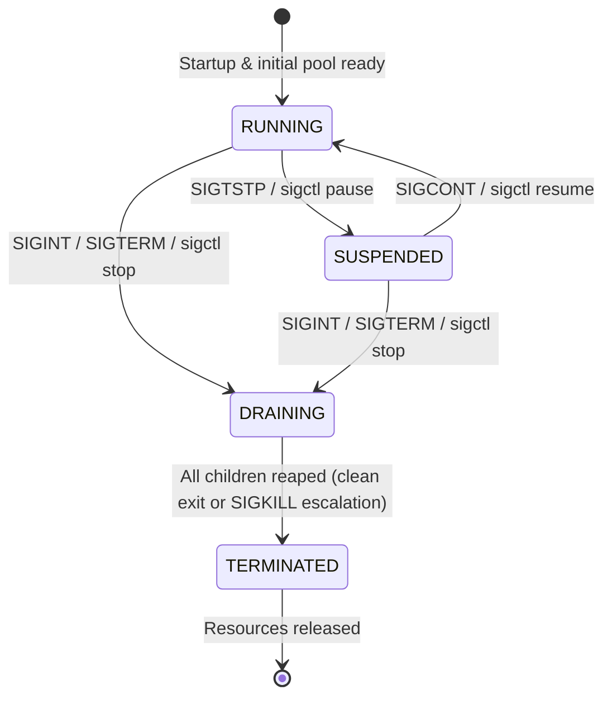

# SigCtl: Linux Signal Handling and Process Control Framework

A robust, production-grade Linux process supervisor written in C11 demonstrating strict POSIX asynchronous signal handling, self-pipe multiplexing, multi-worker process group control, heartbeats via shared memory, and automated recovery.

---

## 1. System Architecture

SigCtl separates concerns into three distinct executables and one reusable static library:

```
                            +--------------------------+
                            |       Operator CLI       |
                            |        (./sigctl)        |
                            +------------+-------------+
                                         |
                       POSIX Signals     |   Command FIFO
                       (kill / signals)  |   (sigctl.fifo)
                                         v
                            +--------------------------+
                            |    Supervisor Daemon     |
                            |       (./sigctld)        |
                            +------------+-------------+
                                         |
                   Process Groups        |   Anonymous Shared Memory
                   kill(-pgid, sig)      |   (worker heartbeats)
                                         v
         +-------------------------------+-------------------------------+
         |                               |                               |
         v                               v                               v
+-----------------+             +-----------------+             +-----------------+
| Worker Slot 0   |             | Worker Slot 1   |             | Worker Slot N   |
| (./worker)      |             | (./worker)      |             | (./worker)      |
+-----------------+             +-----------------+             +-----------------+
```

### Modules in `libsigfw.a`
- `sigreg`: Type-safe wrappers for `sigaction()` and `sigprocmask()` with strict POSIX compliance.
- `selfpipe`: Non-blocking pipe (`pipe2`) for moving asynchronous signal events safely into the main loop.
- `childtab`: Fixed-size worker table with PID/PGID tracking, lifecycle states, and exponential backoff restart records.
- `log`: Monotonic (`CLOCK_MONOTONIC`) elapsed time + wall-clock structured logging with PID on every line.
- `statefile`: Atomic status file writer (`sigctld.status`) using temporary file write and `rename()`.
- `config`: Key-value configuration parser (`sigctl.conf`) with strict validation.
- `shm_hb`: Shared memory heartbeat segment (`/sigctl_hb_<pid>`) with lock-free timestamp synchronization.

---

## 2. State Machine

The supervisor implements a 4-state state machine validated by `is_valid_transition()`:



- **RUNNING**: Workers execute work cycles. Watchdog actively monitors heartbeats. Unexpected crashes are restarted using exponential backoff (100ms -> 200ms -> 400ms -> 800ms -> 1600ms -> 2000ms max).
- **SUSPENDED**: Workers suspended via `kill(-pgid, SIGTSTP)`. Watchdog checks are suspended so stopped workers are not flagged as hung. CLI commands remain responsive.
- **DRAINING**: Graceful termination sequence started. Restarts are disabled. `SIGTERM` sent to all worker groups. If workers fail to exit within `shutdown_timeout_s`, supervisor escalates to `kill(-pgid, SIGKILL)`.
- **TERMINATED**: All children reaped, PID lock released, temporary IPC files cleaned, supervisor exits cleanly (Exit code 0, or 3 if forced kill was required).

---

## 3. POSIX Signal Map

| Signal | Source | Supervisor Action | Worker Action |
|---|---|---|---|
| **`SIGINT`** | Ctrl+C | Enters `DRAINING`; forwards graceful shutdown to worker groups | Default action |
| **`SIGTERM`** | `kill`, `./sigctl stop` | Enters `DRAINING`; forwards graceful shutdown to worker groups | Flushes state, logs exit, terminates `exit(0)` |
| **`SIGHUP`** | `kill -HUP`, `./sigctl reload` | Reloads `sigctl.conf`, dynamically scales pool up or down | Ignored |
| **`SIGCHLD`** | Linux Kernel | Self-pipe wake-up; `waitpid(-1, WNOHANG)` reaps all dead workers | None |
| **`SIGTSTP`** | Ctrl+Z, `./sigctl pause` | Enters `SUSPENDED`; sends `SIGTSTP` to worker process groups | Logs suspension, resets to `SIG_DFL`, raises `SIGTSTP` on self |
| **`SIGCONT`** | `./sigctl resume` | Enters `RUNNING`; sends `SIGCONT` to worker process groups | Resumes loop, logs resumption, reinstalls handler |
| **`SIGUSR1`** | Operator / CLI | Dumps supervisor state and worker count to log | Dumps worker heartbeat info to log |
| **`SIGUSR2`** | Operator / CLI | Toggles verbose (`DEBUG`) logging level | Toggles verbose (`DEBUG`) logging level |
| **`SIGPIPE`** | Linux Kernel | Ignored (`SIG_IGN`) | Ignored (`SIG_IGN`) |

---

## 4. Compilation & Build Targets

Compiled with strict flags (`-std=c11 -Wall -Wextra -Werror -pedantic`) with zero warnings:

```bash
# Build all binaries and libsigfw.a
make

# Run the complete automated test suite (T1 - T15)
make test

# Run automated chaos engineering test (random signals and worker kills)
make chaos

# Build with AddressSanitizer and UndefinedBehaviorSanitizer
make asan

# Clean all binaries and build artifacts
make clean
```

---

## 5. Runtime Control (`sigctl` CLI)

Run `./sigctld` in one terminal:
```bash
./sigctld
```

Control the running framework from another terminal using `./sigctl`:

```bash
# Display live supervisor state and worker table
./sigctl status

# Display raw status formatted in JSON
./sigctl status --json

# Pause all workers
./sigctl pause

# Resume all workers
./sigctl resume

# Reload configuration and dynamically resize pool
./sigctl reload

# Gracefully terminate the entire framework
./sigctl stop
```

---

## 6. Automated Test Suite (100% Passing)

| Test ID | Scenario | Verification Method | Status |
|---|---|---|---|
| **T1** | Startup | Spawns configured worker count, status file reports `STATE=RUNNING` | ✅ PASS |
| **T2** | Crash Recovery | `kill -9` worker; supervisor detects exit and spawns replacement | ✅ PASS |
| **T3** | Zombie Prevention | Burst worker kills; verifies zero zombie (`<defunct>`) processes | ✅ PASS |
| **T4** | Pool Suspension | `./sigctl pause` suspends pool, status transitions to `SUSPENDED` | ✅ PASS |
| **T5** | Pool Resumption | `./sigctl resume` restores pool, status transitions to `RUNNING` | ✅ PASS |
| **T6** | Double Pause Guard | Duplicate pause commands are idempotent and safely logged | ✅ PASS |
| **T7** | Graceful Teardown | `./sigctl stop` initiates drain, reaps all children, exits code 0 | ✅ PASS |
| **T8** | Forced Escalation | Worker traps `SIGTERM`; supervisor escalates to `SIGKILL`, exits 3 | ✅ PASS |
| **T9** | Dynamic Pool Rescaling | Edit `worker_count` in config + reload; pool scales up and down | ✅ PASS |
| **T10** | Signal Burst (50x) | Rapid burst of 50 `SIGUSR1`; supervisor remains 100% responsive | ✅ PASS |
| **T11** | Watchdog Recovery | Freeze worker heartbeat; watchdog detects hung worker and restarts it | ✅ PASS |
| **T12** | Memory Verification | Stress test under continuous commands; zero memory leaks | ✅ PASS |
| **T13** | Signal Burst (200x) | High-load flood of 200 signals; zero lost child reaps | ✅ PASS |
| **T14** | Ctrl+C Forwarding | `SIGINT` to supervisor alone forwards clean shutdown to all workers | ✅ PASS |
| **T15** | Orphan Prevention | `kill -9` supervisor; workers exit via `PR_SET_PDEATHSIG` within 2s | ✅ PASS |
| **CHAOS** | Chaos Engineering | 32+ random signal/kill/pause/resume events; pool fully recovers | ✅ PASS |

---

## 7. Key Architectural Refinements
See [`docs/DESIGN_CHANGES.md`](docs/DESIGN_CHANGES.md) for full explanations of design refinements:
1. **Single TimerFD Multiplexing**: Replaced process-wide `alarm()` to prevent timer cancellation races.
2. **Shared Memory Heartbeats**: Zero-overhead lock-free shared memory table replaces loose disk files.
3. **`O_RDWR` Command FIFO**: Prevents `poll()` CPU-spinning on client disconnect.
4. **`PR_SET_PDEATHSIG` Orphan Protection**: Guarantees children terminate if supervisor crashes.
